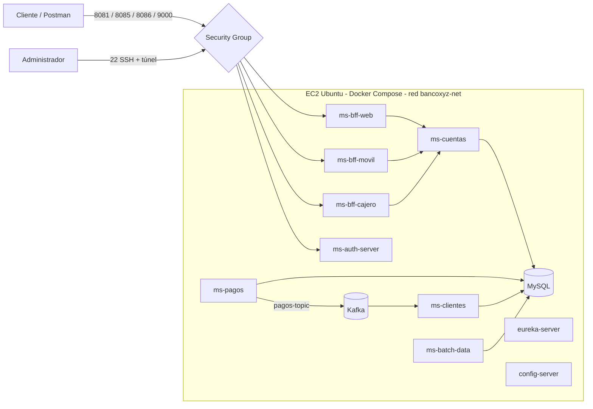

# Despliegue del sistema en la nube (AWS) — Banco XYZ (EFT Semana 9)

Este documento explica cómo desplegar el sistema completo en **AWS** usando una instancia **EC2** con **Docker Compose**, la misma orquestación que se usa en local.

## 1. Estrategia de despliegue

Se despliega una sola instancia EC2 que ejecuta los 12 contenedores del `docker-compose.yml`. El Compose ya está probado en local y no exige cambios de código.



Solo los BFF y el servidor de autorización quedan accesibles desde internet. Todo lo demás (base de datos, Kafka, Eureka, Config Server y batch) permanece cerrado en el Security Group.

## 2. Requisitos previos

- Cuenta de AWS con permisos para crear instancias EC2, grupos de seguridad, pares de claves e IP elásticas.
- El código del proyecto en **un único repositorio de GitHub** que contenga todos los módulos y el `docker-compose.yml` en la raíz.
- En el equipo local: un cliente SSH (o PowerShell) y Postman.
- Región única de AWS elegida.

## 3. Dimensionamiento de la instancia

El sistema ejecuta 10 aplicaciones Java, MySQL y Kafka. Con 12 contenedores la memoria es el factor limitante:

| Recurso | Recomendación / Estimación |
|---|---|
| Tipo de instancia | `t3.large` (2 vCPU, 8 GiB) como mínimo; `t3.xlarge` (4 vCPU, 16 GiB) si la construcción de imágenes resulta muy lenta |
| Almacenamiento | 30 GiB gp3 (imágenes Docker, caché de Maven y volumen de MySQL) |
| Sistema operativo | Ubuntu Server 24.04 LTS |
| IP | Elastic IP |

Una instancia de 4 GiB o menos no es suficiente: los servicios se reinician por falta de memoria. Proyecto se ejecuta en local con un aproximado de 20 GB en uso durante el despliegue completo.

## 4. Paso 1 — Crear el grupo de seguridad

En la consola de EC2: *Network & Security → Security Groups → Create security group*. Nombre sugerido: `bancoxyz-sg`.

**Reglas de entrada (Inbound):**

| Puerto | Origen | Para qué |
|---|---|---|
| 22 (SSH) | *My IP* | Administración remota |
| 9000 | *My IP* | Servidor de autorización (obtener tokens) |
| 8081 | *My IP* | BFF Web |
| 8085 | *My IP* | BFF Móvil |
| 8086 | *My IP* | BFF Cajero |

No se requiere abrir estos puertos, aunque `docker-compose.yml` los publique en el host: 3306 (MySQL), 29092 (Kafka), 8761 (Eureka), 8888 (Config Server), 8080 (batch, **no tienen autenticación**) y 8082–8084 (Cuentas, Pagos y Clientes, tampoco estan autenticados). El Security Group es la barrera que los mantiene privados.


## 5. Paso 2 — Crear la instancia EC2

*EC2 → Instances → Launch instances*:

1. **Nombre:** `bancoxyz-eft9`.
2. **AMI:** Ubuntu Server 24.04 LTS (64 bits, x86).
3. **Tipo de instancia:** `t3.large`.
4. **Par de claves:** Por ejemplo `bancoxyz-key`, formato `.pem` y guardar el archivo en un lugar seguro.
5. **Red:** selecciona el grupo de seguridad `bancoxyz-sg`.
6. **Almacenamiento:** 30 GiB, tipo gp3.
7. Lanza la instancia y espera a que su estado sea *Running* con las dos comprobaciones de estado superadas.

Luego asigna una **Elastic IP**: *EC2 → Elastic IPs → Allocate Elastic IP address → Associate* con la instancia. En adelante, `<IP-PUBLICA>` en este documento es esa dirección.

## 6. Paso 3 — Conectarse por SSH

Desde PowerShell (Windows) o una terminal (macOS/Linux):

```bash
ssh -i "bancoxyz-key.pem" ubuntu@<IP-PUBLICA>
```


## 7. Paso 4 — Instalar Docker y Git

Ya dentro de la instancia:

```bash
sudo apt-get update
sudo apt-get install -y git
curl -fsSL https://get.docker.com | sudo sh
sudo usermod -aG docker ubuntu
```

Cierra la sesión (`exit`) y vuelve a conectarte para que el cambio de grupo tenga efecto. Verifica:

```bash
docker --version
docker compose version
```

## 8. Paso 5 — Obtener el código

```bash
git clone https://github.com/Rai-Morroni/PBY2203-Backend-III-2026-EFT.git
cd "Proyecto EFT Semana 9"
ls
```

## 10. Paso 6 — Construir y levantar el sistema

```bash
docker compose up -d --build
```

Seguimiento: 
```bash
docker compose ps
docker compose logs -f ms-bff-movil
```

Deben quedar los **12 contenedores** en `running`, y `mysql-batch`, `eureka-server` y `config-server` en `healthy`. El docker compose controla que cada microservicio se ejecute esperando sus dependencias.

## 11. Paso 8 — Verificar el despliegue

### 11.1 Desde la instancia (todo el sistema)

```bash
http://localhost:8761/          # Eureka responde
http://localhost:8888/ms-bff-web/default  # Config Server entrega la configuración
```


## 12. Alcance y estado de validación

- **Validado:** la ejecución completa con Docker Compose en un equipo local (12 contenedores, registro en Eureka, emisión y validación de tokens, batch, flujo Kafka y consulta a través del BFF Móvil).
- **Documentado, no ejecutado en AWS:** los pasos descritos siguen el procedimiento estándar de EC2 con Docker.

