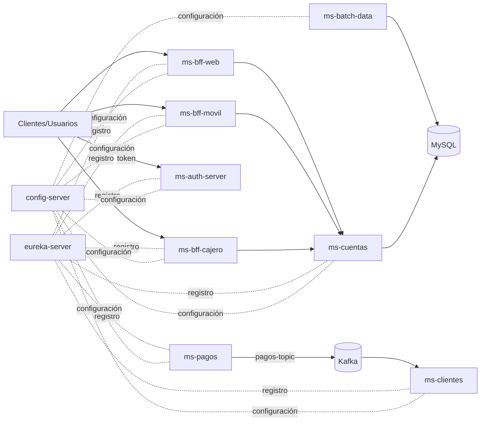

# Banco XYZ — Modernización a microservicios

**Evaluación Final Transversal (Semana 9) · PBY2203 Desarrollo Backend III · Duoc UC**
Autor: Rainiero Morroni

**Repositorio:** https://github.com/Rai-Morroni/PBY2203-Backend-III-2026-EFT

Este README corresponde al proyecto raíz de la carpeta `Proyecto EFT Semana 9` y documenta la solución desarrollada para modernizar los procesos del banco legacy hacia una arquitectura distribuida con Spring Boot, Spring Cloud, Kafka y Docker Compose.

## Descripción general

El Banco XYZ opera con sistemas heredados basados en COBOL y scripts Unix/Mainframe. El objetivo del proyecto es migrar sus procesos críticos a una arquitectura de microservicios con responsabilidad clara por dominio y con despliegue reproducible en contenedores.

La solución incluye tres capas principales:

- **Parte 1 — Batch:** migración de los procesos legacy a Spring Batch con carga desde CSV, validación, persistencia en MySQL y manejo de rechazos.
- **Parte 2 — BFF:** APIs por canal (`web`, `movil`, `cajero`) con autenticación basada en JWT y separación de responsabilidades.
- **Parte 3 — Microservicios:** dominio de negocio para cuentas, pagos y clientes, con configuración centralizada, registro del servicio y eventos asíncronos.

## Arquitectura



| Módulo | Puerto | Rol |
|---|---|---|
| `eureka-server` | 8761 | Registro y descubrimiento de servicios |
| `config-server` | 8888 | Configuración centralizada desde `config-repo` |
| `ms-auth-server` | 9000 | Servidor OAuth2 que emite tokens JWT |
| `ms-batch-data` | 8080 | Ejecuta jobs de Spring Batch vía API REST |
| `ms-cuentas` | 8082 | Consulta y validación de cuentas |
| `ms-pagos` | 8083 | Procesa pagos y publica eventos a Kafka |
| `ms-clientes` | 8084 | Consume eventos de pagos y los procesa |
| `ms-bff-web` | 8081 | BFF para interfaz web |
| `ms-bff-movil` | 8085 | BFF para app móvil con respuesta ligera y resiliencia |
| `ms-bff-cajero` | 8086 | BFF para cajeros automáticos |
| `mysql-batch` | 3306 | Base de datos `bancoxyz_batch` |
| `kafka` | 29092 | Broker de eventos Kafka |

## Stack tecnológico

- Java 21
- Spring Boot 3.x
- Spring Cloud (Config Server, Eureka, OpenFeign, LoadBalancer)
- Spring Batch 5
- Spring Security OAuth2 (Authorization Server + Resource Server)
- Resilience4j
- Apache Kafka
- MySQL 8
- Maven
- Docker + Docker Compose

## Requisitos previos

- Docker Desktop o Docker Engine con Compose v2
- Git
- 16 GB de RAM recomendados como mínimo para levantar la infraestructura completa
- Puertos libres: 3306, 8080-8086, 8761, 8888, 9000 y 29092

## Inicio rápido

Desde la raíz del proyecto:

```bash
git clone https://github.com/Rai-Morroni/PBY2203-Backend-III-2026-EFT.git
cd "Proyecto EFT Semana 9"
docker compose up -d --build
docker compose ps
```

La primera ejecución puede tardar varios minutos porque Docker compila y levanta todos los módulos. Cuando termine, `docker compose ps` debería mostrar 12 contenedores activos y Eureka en `http://localhost:8761` debería listar los servicios registrados.

### Prueba mínima

```bash
# 1) Ejecutar un job batch
curl -X POST http://localhost:8080/api/batch/estados-anuales

# 2) Obtener un token OAuth2
curl -u bff-client:bff-secret -d "grant_type=client_credentials&scope=read write" http://localhost:9000/oauth2/token

# 3) Consultar el BFF Móvil con el token
curl -H "Authorization: Bearer <token>" http://localhost:8085/api/v1/movil/resumen/2
```

Nota: en Windows PowerShell usa `curl.exe` en lugar de `curl`. Para detener el entorno: `docker compose down`. Si quieres limpiar también la base de datos: `docker compose down -v`.

## Documentación del proyecto

| Documento | Contenido |
|---|---|
| [`instrucciones.md`](instrucciones.md) | Ejecución paso a paso, pruebas y validaciones de cada componente |
| [`despliegue.md`](despliegue.md) | Guía de despliegue y preparación para AWS |

## Estructura del repositorio

```text
.
├── docker-compose.yml         # Orquestación de infraestructura y microservicios
├── instrucciones.md           # Guía de ejecución y pruebas
├── despliegue.md              # Despliegue en AWS
├── config-server/             # Servidor de configuración centralizada
├── eureka-server/             # Registro y descubrimiento
├── ms-auth-server/            # OAuth2 / emisión de JWT
├── ms-batch-data/             # Jobs Spring Batch y validaciones
├── ms-cuentas/                # Microservicio de cuentas
├── ms-pagos/                  # Microservicio de pagos y eventos
├── ms-clientes/               # Microservicio que consume eventos Kafka
├── ms-bff-web/                # BFF para web
├── ms-bff-movil/              # BFF para móvil
├── ms-bff-cajero/             # BFF para cajeros
├── Consultas Tablas Batch - EFT 9.sql
└── README.md                  # Documentación general del proyecto
```

## Decisiones de diseño destacadas

- **Batch idempotente:** cada fila se identifica por archivo y número de línea; las ejecuciones repetidas devuelven 409 y se evita la duplicación de registros.
- **Seguridad:** los BFF validan tokens JWT emitidos por `ms-auth-server` bajo el flujo `client_credentials` de OAuth2.
- **Resiliencia:** el BFF Móvil utiliza OpenFeign y Resilience4j para proteger llamadas a `ms-cuentas` mediante circuit breaker.
- **Eventos:** `ms-pagos` publica mensajes en Kafka y `ms-clientes` los consume como proceso asíncrono.
- **Configuración centralizada:** servicios y módulos obtienen su configuración desde `config-server` y se registran en `eureka-server`.

## Estado del proyecto

Este proyecto está orientado a la evaluación académica y a la demostración de una moderna arquitectura backend, con separación de responsabilidades entre batch, BFF, autenticación y microservicios de negocio. Sirve como base para comprensión de integración entre Spring Cloud, OAuth2, resiliencia y mensajería distribuida.

